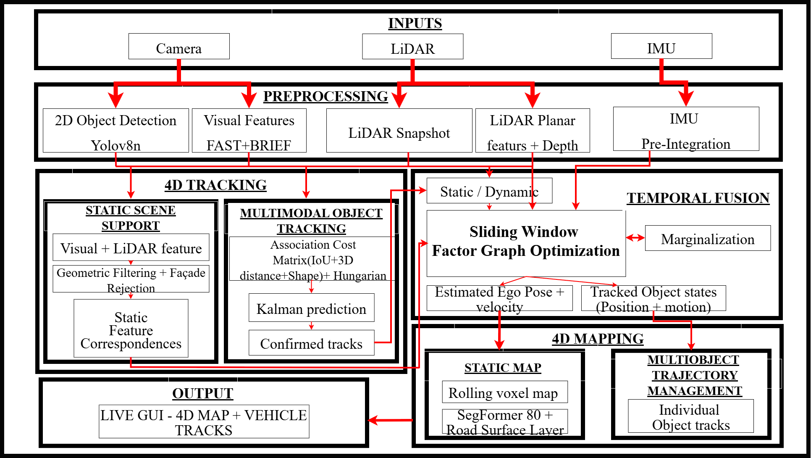

# LVIMOT — LiDAR–Visual–Inertial Localization, Multi-Object Tracking and 4D Mapping

A Python research project integrating **RGB camera, LiDAR and IMU** observations
in **CARLA 0.9.13** to estimate ego motion, track surrounding vehicles and build
a measured 3D/4D scene. CARLA ground truth is used for post-estimation
evaluation, not as an estimator input (as documented in the pipeline and
recorded result).



## Explore the results first

- [Open the example offline 4D map](examples/final_run/offline_4d_map.html)
  (download/open locally if GitHub does not render interactive HTML).
- [Final-run metrics (JSON)](examples/final_run/live_results.json)
- [What the final example contains](examples/final_run/README.md)
- [Detailed architecture and source locations](docs/ARCHITECTURE.md)

The uploaded final run has **197 processed frames**, **62.89% MOTA**, **1.716 m
ego ATE RMSE**, **91.38% measured road-layer agreement** and **1.10 FPS**.
These are **run-specific results**, not general accuracy guarantees. The road
metric applies to the camera-observed measured LiDAR road layer; it does not
validate the entire 3D map. Tracking recall and processing speed remain
limitations. The independent full-scene CARLA reference was unavailable in
this final result, so complete 3D acceptance was not established.

## Architecture

| Stage | Implementation |
| --- | --- |
| Inputs | `lvimot/inputs/` |
| Preprocessing | `lvimot/preprocessing/` |
| 4D tracking | `lvimot/tracking_4d/` |
| Temporal fusion | `lvimot/temporal_fusion/` |
| 4D mapping | `lvimot/mapping_4d/` |
| Output and evaluation | `lvimot/output/` |

The pipeline includes YOLOv8n vehicle detection, visual features, measured
LiDAR features, Kalman/Hungarian tracking, sliding-window factor graph
optimization and rolling/accumulated mapping. A separate SegFormer-B0 road
segmentation model labels image pixels; measured LiDAR supplies road geometry.
See [architecture details](docs/ARCHITECTURE.md) for the exact implementation.

## Requirements

- **CARLA 0.9.13**, installed separately (CARLA binaries are not in this ZIP).
- **Python 3.8 x64** for the verified Windows environment.
- Dependencies from `requirements.txt`, including PyTorch as set up by the
  Windows environment script. The provided weights are in `models/`.
- A GPU is recommended for inference; CPU execution may be slow.

### Windows (primary development environment)

1. Extract the project and install CARLA 0.9.13 separately.
2. Install Python **3.8 x64** and ensure the Windows `py` launcher is available.
3. Double-click `run_lvimot_gui.bat` from the project folder. On first launch
   it creates `.venv_live38` and installs the dependencies; internet is needed.
4. In the GUI, set the **CARLA Install** directory to your own CARLA
   `WindowsNoEditor` folder. Use the GUI's save-config option if desired.
5. Start CARLA from the GUI or connect to an already running CARLA server,
   then start LVIMOT. Outputs are written under `outputs_carla/`.

For optional GPU runtime setup, run `scripts/setup_cuda_runtime.bat` once.
The included `scripts/start_carla_0913.bat` helper accepts the CARLA directory
as its first argument or reads the `CARLA_INSTALL` environment variable.

### Linux / Ubuntu (experimental, not verified by this release)

1. Install a CARLA 0.9.13 build and Python environment compatible with your
   Linux system. The Windows-specific environment setup script does not apply.
2. Install the Python dependencies from `requirements.txt` in a compatible
   environment and make sure CARLA's Python API can import successfully.
3. Set the CARLA installation path in the GUI and run:

```bash
sh scripts/run_lvimot_gui.sh
```

The Linux launcher uses `.venv_live38/bin/python` when available, otherwise
`python3`. **Linux functionality has not been validated here.** Do not assume
Windows performance or setup instructions transfer unchanged to Linux.

## CLI, tests and offline tools

```bash
python -m lvimot --help
python -m pytest -q
python tools/regenerate_offline_html.py --help
```

Some legacy tests require external CARLA datasets and skip when absent.
A full local test run also requires the dependencies in `requirements.txt`,
including `ultralytics`; see `docs/PUBLICATION_CHANGES.md` for packaging checks.
Recorded replay and geometry comparison tools are in `tools/`; see
[tools/README.md](tools/README.md). An independent CARLA reference must match
the evaluated route for meaningful full-scene geometry comparison.

## Folder structure and outputs

- `lvimot/` — six-stage runtime Python pipeline
- `models/` — pretrained detection and road-segmentation artifacts
- `config/` — sensor and evaluation settings
- `scripts/` — launch and setup helpers
- `tests/` — regression tests and manual diagnostics
- `tools/` — offline analysis and visualization utilities
- `docs/` — architecture, historical validation and change records
- `examples/final_run/` — the 197-frame final metrics and standalone HTML
- `lvimot_gui_config.example.json` — example user settings; the live GUI writes
  its own `lvimot_gui_config.json` (ignored by Git) when saved

`outputs_carla/`, CARLA installations, virtual environments, raw sensor
captures and independently generated reference PLYs are **not committed**.

**Historical note:** `docs/VALIDATION_20261022.md` documents an earlier
105-frame offline validation and references assets not included in the
original uploaded final ZIP. Do not confuse it with the 197-frame sample.

## Original Research and Acknowledgements
This project is based on the research paper:
**Shaoquan Feng, Xingxing Li, Zhuohao Yan, Yuxuan Zhou, and Chunxi Xia**, “LVIMOT: Accurate and robust LiDAR-visual-inertial localization and multi-object tracking in dynamic environments via tightly coupled integration,” *ISPRS Journal of Photogrammetry and Remote Sensing*, vol. 230, pp. 675–692, 2025.

Full credit for the original LVIMOT research methodology and scientific contributions belongs to the authors.

This repository presents an independent CARLA-based implementation and development project inspired by the published research, with additional simulation integration, perception components, visualization, mapping and evaluation features.

This repository is not an official implementation maintained or endorsed by the original paper's authors.

## License and scope

See [third-party notices](THIRD_PARTY_NOTICES.md). SegFormer-B0 is supplied
with an NVIDIA license restricting its use to non-commercial research and
evaluation. A project-wide source license has **not** been selected; public
access does not automatically authorize reuse or redistribution.

This is a research demonstration, not a safety-certified autonomous system.
